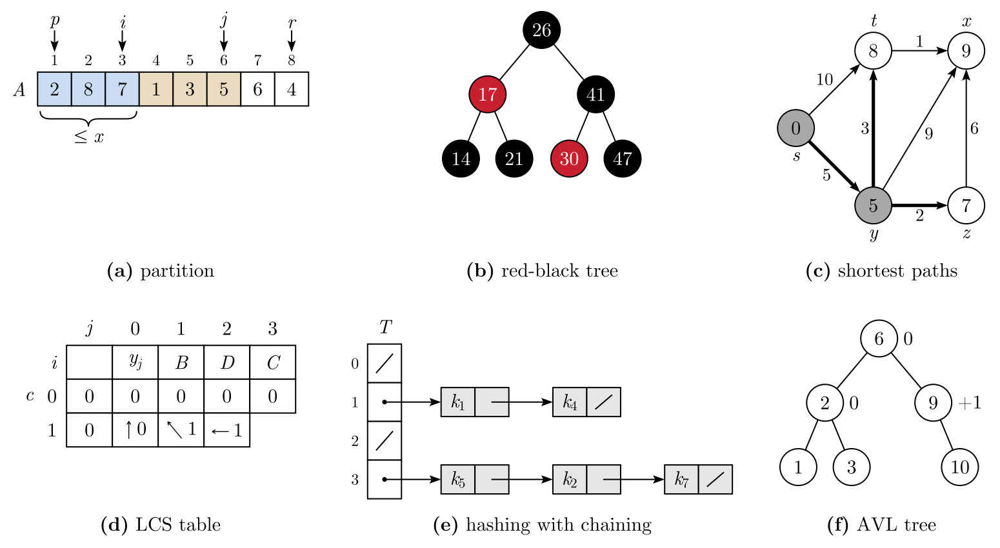
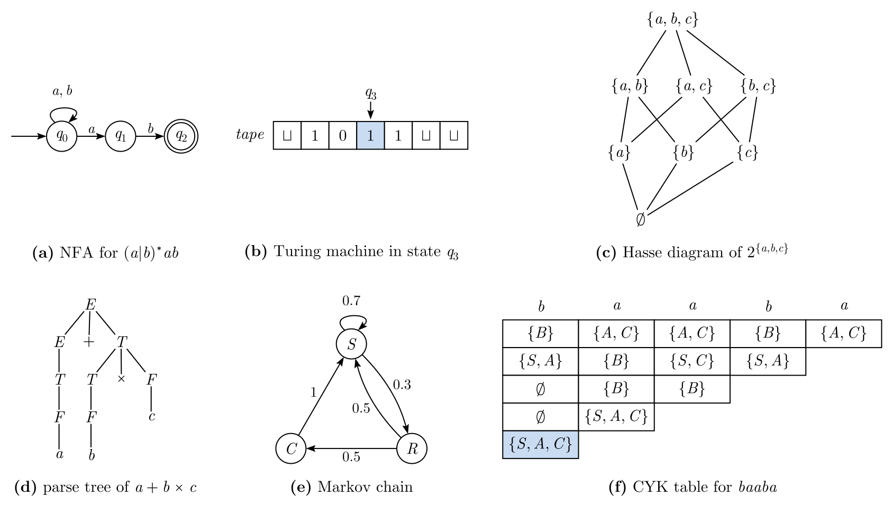

# Figure Suite

Draw figures for algorithms, data structures and theoretical computer science from a few lines of text: arrays and DP tables, trees, graphs and automata, linked lists and hash tables, in the clean style of textbooks such as *Introduction to Algorithms* (CLRS). Edit the text in a panel with a live preview, then insert the figure into your note as PNG or SVG. The source is stored inside the image, so you can reopen and change the figure at any time.

[中文说明](README.zh-CN.md)





## Features

- **Six building blocks** cover most figures in algorithms, data structures, automata and formal languages, logic and discrete math: `array`, `table`, `tree`, `graph`, `list` / `chains`, plus panels, arrows and text to combine them.
- **Automatic layout.** Trees use a tidy layout, and graphs can be layered, force-directed, circular, in a grid or in a row. You can also place nodes yourself, or drag them in the preview and the coordinates are written back to the source.
- **TeX-quality labels**: `x_1`, `n^2`, `\frac{n}{2}`, `\alpha`, `\le`, `\vdash`, `\subseteq`, `\oplus`, `\hat{x}`, `NIL` in small caps, all in Computer Modern. The fonts are built into the plugin, so the preview, PNG and SVG look the same on every machine.
- **Export** to a PNG at 1–4× resolution or an SVG, to the clipboard, or straight into the note. Inserted links carry the 1× width, so high-resolution images keep their size.
- **Re-editable.** Hover over a figure in a note and click the pencil icon to reopen it. **Update** overwrites the file in place and keeps the links working.
- **Helpful editor.**
  - 30 starter templates and a searchable built-in syntax reference (English and 中文) whose examples you can insert with one click.
  - Errors and warnings point at the line, including typos, out-of-range indices and unknown commands.

## Getting started

1. Run **Figure Suite: New figure** from the command palette or the ribbon, or right-click in the editor and choose **Insert figure…**.
2. Pick a template (the first toolbar button), or type a figure:

   ```
   tree
     6 right=0
       2 right=0
         1
         3
       9 right=+1
         _
         10
   ```

3. Press **Insert** (or `Mod+Enter`). The figure is saved to your attachment folder and embedded at the cursor.
4. To change it later, hover over the image and click the pencil icon. You can also right-click the link and choose **Edit figure**, or run **Edit figure at cursor**.

Open **Syntax help** (the `?` button in the panel) for the full reference with examples.

## What you can draw

| Block | For |
|---|---|
| `array` | arrays, stacks and queues, sorting steps (pointers, braces, shaded ranges, arcs), counting sort, string matching, Turing machine tapes |
| `table` | DP tables with arrows (LCS, CYK), matrices, adjacency matrices, truth tables, transition tables, binary counters, radix sort |
| `tree` | BSTs, heaps, AVL and red-black trees (NIL sentinels), B-trees, rotations (subtree triangles), recursion trees, Huffman trees, disjoint-set forests, parse trees, game trees, tries |
| `graph` | directed, undirected and weighted graphs, BFS/DFS states, shortest paths, MSTs, flow networks, SCCs, DAGs, bipartite matchings, finite automata (DFA, NFA), Markov chains, Hasse diagrams, reduction gadgets, point sets |
| `list`, `chains` | singly and doubly linked lists; hash tables with chaining, adjacency lists, buckets |
| `panel`, `arrow`, `text` | (a) (b) (c) panels, labelled arrows between them, text |

By course, that covers the usual figures of data structures and algorithms, automata and formal languages, computability and complexity (machines, reductions), discrete math (relations, posets, graphs) and probability (Markov chains).

## Syntax at a glance

A figure is a list of blocks. A block header starts at the left margin; its body is indented. Lines like `shade: …` inside a body are directives. `//` starts a comment.

```
figure cols=2                    // optional: options for the whole figure
panel (a) before                 // a captioned panel
array A
  5 2 4 6 1 3
  shade: 2 black                 // colour cells
  arc: 2 -> 1 below
arrow "insert"                   // arrow to the next panel
panel (b) after
array A
  2 5 4 6 1 3
```

- **Labels** are TeX math: `x_1`, `a_{i,j}`, `v1` (shown as v₁), `\infty`, `\lceil n/2 \rceil`, `\frac{a}{b}`, `\Gamma \vdash \phi`, `A \subseteq B`, `\hat{q}`. Quote a label with spaces: `"n - 1"`.
- **Colours**: `5@red` colours one cell or node. `shade: 2..4 gray` colours several. Names: `white light shade gray dark black red pink blue lightblue green lightgreen yellow orange tan purple`, or `#hex`.
- **array**: `ptr: i=2 j=5`, `span: 1..3 {\le x}`, `bar: 3`, `arc: 2 -> 1`, `index=below`, `start=0`.
- **table**: one line per row, plus `cols:`, `rows:`, `shade: (1,2)`, `arrow: (2,2) -> (1,1)`, `brackets` for matrices.
- **tree**: indentation gives the children.
  - `_` is an empty slot, `nil` a NIL sentinel, `[G M P]` a B-tree node, `"α" tri` a subtree triangle.
  - `left= right= above= below=` add notes next to a node; `edge=`, `thick` and `dashed` style the edge to the parent.
  - `level:` adds a note to a whole level.
- **graph**: edges are written `a -> b 10`, `a -- b` or `a <-> b`.
  - Declare a node to set its label, position (`(x,y)`), shape or colour.
  - `layout=auto|layered|force|circle|grid|line|manual`; `dir=up` draws a layered layout bottom-up (Hasse diagrams).
  - `group:`, `rank:` and `shade:` work on nodes; `bend=`, `loop=` and `swap` shape edges.
- **list / chains**: `list L.head double` with the keys in the body; `chains T` with a line like `1: k1 k4` for each slot.

The in-app reference lists every option.

## Settings

- Default format (PNG or SVG) and PNG resolution
- Background (white or transparent)
- Font size
- Fill colour for linked lists
- File name prefix
- Whether the source is stored in the image
- Whether `|width` is added to inserted links
- Language of the syntax reference

## Notes

- **Desktop only.** PNG export and the clipboard rely on desktop features.
- **No network access.** Everything runs locally. The figure source is stored in the PNG (`iTXt` chunk) or SVG (`<metadata>`) it produces; turn off **Embed source in images** if you'd rather not keep it.
- **Characters missing from Computer Modern** (for example CJK, and the letters of `\mathbb` and `\mathcal`) fall back to the system serif font. That font isn't embedded in SVG exports, so an SVG may look different on another machine; PNG is unaffected.
- Automatic graph layouts are a starting point; for complex graphs, dragging a few nodes is the quickest fix.

## Development

The plugin is plain JavaScript with no dependencies. `build.py` concatenates `src/` into `main.js`, and `tools/subset-fonts.js` subsets the fonts into `src/fontdata.js`.

```bash
python3 build.py            # build main.js and styles.css
node tests/test-engine.js   # parser, labels, every template and help example, PNG/SVG round trips
```

| File | Purpose |
|---|---|
| `src/font.js` | TrueType reader (cmap, hmtx, glyf) |
| `src/mathtext.js` | mini TeX typesetter |
| `src/parse.js` | figure source parser and option checks |
| `src/blocks.js` | array, table, list, chains, text, arrow |
| `src/tree.js` | tidy tree layout |
| `src/graph.js` | graph layouts, edges, loops, groups |
| `src/compose.js` | panels and the final SVG |
| `src/export.js` | PNG rasterising, source embedding, clipboard |
| `src/panel.js` | the editor panel |
| `src/help.js` | the syntax reference |
| `src/main.js` | commands, menus, the edit button, settings |

## License

MIT, see [LICENSE](LICENSE). The bundled CMU Serif fonts (Computer Modern by Donald E. Knuth, converted by Andrey V. Panov) are licensed under the SIL Open Font License 1.1, see [fonts/OFL.txt](fonts/OFL.txt).
